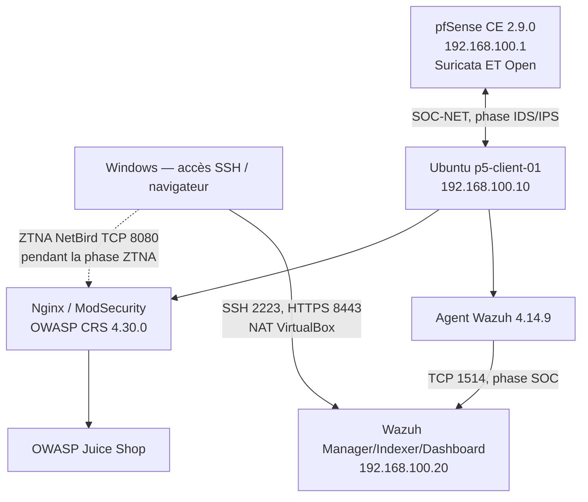

# Projet 5 — Refonte de la sécurité périmétrique | AtlasCloud

 

**La Plateforme_ · Cybersécurité · soutenance du 2 novembre 2026**  
**Contexte pédagogique :** AtlasCloud, scale-up SaaS B2B de 250 salariés, croissance de 60 %/an. Le SI initial comporte un SonicWall ancien, un VPN SSL historique, peu de segmentation et aucun WAF.

## Résumé exécutif
Ce dépôt documente un PoC local de défense en profondeur avec **pfSense CE + Suricata**, **Nginx + ModSecurity + OWASP CRS**, **NetBird ZTNA** et **Wazuh 4.14.9**. La protection WAF a refusé une injection SQL (HTTP **403**, CRS **942100** / **949110**), et l'agent Ubuntu l'a transmise à Wazuh (règle locale **100501**, niveau **10**, visible dans Threat Hunting). Les tests IPS ICMP et de contrôle d'accès ZTNA ont également été validés séparément.

> **Portée :** PoC académique. Les composants ne sont pas tous restés actifs simultanément ; pfSense/Suricata et Wazuh ont été testés par phases à cause de la RAM du poste. Les alertes Suricata et NetBird n'ont **pas** été prouvées comme centralisées dans Wazuh. Le contrôle OIDC Authelia, Headscale autohébergé, la vidéo de démonstration et un audit trail multi-source intégral ne sont pas réalisés. L'usage d'un plan de gestion NetBird externe **s'écarte de la contrainte « pas de cloud » du sujet** : l'écart est explicite et la cible propose Headscale/Authelia locaux.

## Démarrage rapide
1. Lire [rapport.md](rapport.md), [note-cadrage.md](docs/note-cadrage.md), [architecture-cible.md](docs/architecture-cible.md) et [tests.md](docs/tests.md).
2. Recréer les deux conteneurs WAF/juice-shop sur un Ubuntu **dédié au lab** : `cd config/docker && docker compose -f compose.yaml up -d` (ou, si la distribution Compose est en cours, renommer en `compose.yaml`). Vérifier les paramètres et versions avant la mise en route : ce fichier est une **reconstruction basée sur les configurations connues, non un export original**.
3. Test contrôlé : `bash scripts/test-waf.sh` (test uniquement sur `127.0.0.1:8080`).
4. Pour les instructions pfSense, NetBird et Wazuh, voir [config/README.md](config/README.md). Ne pas copier les adresses de laboratoire vers un environnement de production.

## Architecture de laboratoire

**Note :** le graphe illustre les flux testés à des moments différents, pas une simultanéité garantie de toutes les VM. Schémas supplémentaires : [docs/diagrammes.md](docs/diagrammes.md) et [diagrams/](diagrams/).

## Résultats clés

| Contrôle | Scénario | Preuve | État |
|---|---|---|---|
| IDS Suricata | ICMP + scan nmap | Alertes SID 1000001 / scan | ✅ |
| IPS Suricata | ICMP avec règle DROP | Alerte DROP + ping non abouti | ✅ |
| WAF | Requête normale / SQLi | HTTP 200 / 403, 942100, 949110 | ✅ |
| NetBird | Autoriser 8080, refuser 22, révoquer 8080 | Captures et tests TCP | ✅ (phase connectée) |
| Wazuh | Inscription agent Ubuntu | ID 001 actif | ✅ |
| SOC | Envoi de journal Docker WAF → alerte | 100501 niveau 10 dans Threat Hunting | ✅ |
| Audit trail Suricata + NetBird dans Wazuh | 3 sources indépendantes | Non réalisé | ⏳ |

## Organisation du dépôt

- `rapport.md` : rapport technique détaillé, chronologie, commandes, preuves et limites.
- `docs/` : note de cadrage, architecture, risques, budget, roadmap, scénarios, dimensionnement, soutenance et écarts au cahier des charges.
- `config/docker/compose.yaml` : configuration **reconstituée** et fonctionnelle à adapter.
- `config/wazuh/` : exemples de collecte sur l'agent, règle locale et configuration réseau.
- `config/suricata/` : règle ICMP de test ; paramètres interfaces à confirmer.
- `scripts/` : tests locaux et sauvegarde de configuration, sans secrets.
- `diagrams/` : diagrammes Mermaid C4-like sous forme de sources modifiables.
- `evidence/` : captures fournies ; `evidence/README.md` indexe les preuves.
- `presentation/` : soutenance modifiable et export PDF.

## Prérequis et limites matérielles
- Poste Windows 16 Gio RAM, VirtualBox ; pfSense 4 Gio (phase pare-feu), Ubuntu initialement 3 puis 2 Gio ; Wazuh 8 puis 6 Gio (phase SOC). **Éviter de démarrer les trois VM ensemble.**
- Windows C: descendait à environ 9 Gio libres : garder une marge, éviter les logs volumineux.
- `SOC-NET` VirtualBox ; pour la phase SOC, Wazuh possède `eth0=192.168.100.20/24` et `eth1=NAT`.
- La sortie Internet Ubuntu via pfSense ne fonctionne pas lorsque ce dernier est arrêté ; paquet Wazuh transféré via SCP depuis Windows.

## Sécurité et publication
Aucun mot de passe réel, clé privée, jeton NetBird, certificat privé ou export d'alertes contenant des secrets ne doit être commité. Les identifiants de démonstration de l'appliance Wazuh doivent être changés avant exposition réseau. Les IPs du dépôt sont des adresses de labo ; `100.76.144.250` est l'IP de test NetBird, non une passerelle publique.

## Licence et sources
Code, documentation et schémas rédigés pour ce dépôt sous **MIT** ([LICENSE](LICENSE)). Les captures et marques des outils tiers restent sous leurs droits respectifs. Voir [docs/references.md](docs/references.md). La licence MIT a été retenue pour faciliter la réutilisation des exemples pédagogiques ; elle n'altère pas les licences des logiciels téléchargés.
