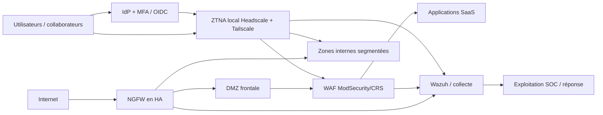

# Architecture cible AtlasCloud — proposition, non déployée

## Principes
Défense en profondeur, moindre privilège, défaut de refus, identités fortes, journalisation centralisée, disponibilité pendant migration, transparence des coûts et variantes open source.

## Options étudiées
| Approche | Avantage | Limite | Décision |
|---|---|---|---|
| VPN SSL plat + pare-feu historique | Changements faibles | Accès réseau trop large, dette technique | Sortie progressive |
| NGFW + DMZ + IDS/IPS + WAF | Contrôles réseau et applicatifs distincts | Pilotage et signatures | Retenu |
| ZTNA avec politique fine | Accès par service/groupes | Identité, gouvernance, relais | Retenu sous conditions |
| SASE managé | Couverture distribuée | Coût, résidence et dépendance fournisseur | Étude ultérieure |

## Vue logique

## Matrice de flux initiale à confirmer
| Source | Destination | Port | Politique cible |
|---|---|---|---|
| Internet | WAF en DMZ | 443 | Autorisé, inspecté |
| WAF | Backend applicatif | 3000 dans PoC / port cible applicatif | Autorisé seulement depuis WAF |
| Utilisateurs autorisés via ZTNA | Service applicatif | 443 | Autorisé par identité/groupe |
| Clients de test | Administration SSH | 22 | Refus par défaut |
| Agents | Manager SIEM | TCP 1514, enrôlement 1515 | Sources explicitement autorisées |
| Infrastructure | SIEM | Syslog TLS ou agent | Collecte filtrée / horodatée |

## Règles opérationnelles
Séparer les zones WAN/DMZ/applicatif/administration/cloud ; préparer une matrice de flux au plus près des usages réels. Politique deny by default après observation. Ajouter SSO/MFA, revues de groupes mensuelles, logs horodatés avec rétention/accès contrôlés, sauvegarde configurations, durcissement TLS, journalisation des actions administratives. Prévoir supervision de disponibilité et retour arrière avant chaque bascule.

## C4
Les trois niveaux **contexte, conteneurs et composants** sont proposés dans `diagrams/01-contexte.mmd`, `02-conteneurs.mmd`, `03-composants-soc.mmd` ; ce sont des vues « C4-like » en Mermaid, non des exports PlantUML officiels C4.
